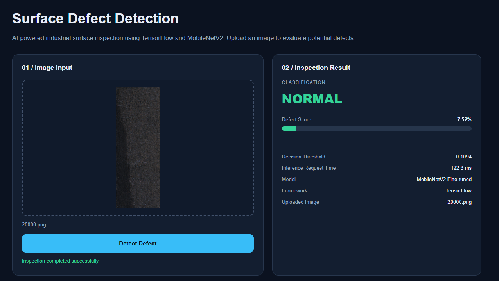

# Industrial Defect Detection with TensorFlow

An industrial surface defect classification project built with TensorFlow, MobileNetV2, FastAPI, and Docker GPU inference.


## Web Interface Demo

Upload an industrial surface image and inspect the
classification result through the browser.



The interface supports image preview, defect classification,
defect score, decision threshold, and HTTP request latency.

The displayed score is not a calibrated probability.


## Project Overview

This project demonstrates an end-to-end computer vision workflow:

1. Dataset preparation
2. Binary defect classification
3. Transfer learning
4. Fine-tuning
5. Model evaluation
6. Classification threshold tuning
7. REST API deployment
8. Docker GPU inference

## Tech Stack

- Python 3.12
- TensorFlow 2.21
- Keras
- MobileNetV2
- tf.data
- FastAPI
- Uvicorn
- Docker
- NVIDIA CUDA / cuDNN

## Dataset

Dataset: KolektorSDD2

Images are classified as:

- `normal` (0)
- `defect` (1)

Labels are derived from ground-truth segmentation masks.

### Dataset Split

| Split | Normal | Defect | Total |
|---|---:|---:|---:|
| Train | 1772 | 209 | 1981 |
| Validation | 313 | 37 | 350 |
| Test | 894 | 110 | 1004 |

The official test split is kept separate from training.

## Model Architecture

Input: 192 × 512 × 3

MobileNetV2:
- ImageNet pretrained weights
- Classification head with Global Average Pooling
- Dropout 0.3
- Dense layer with sigmoid activation

Training strategy:

- Stage 1: Freeze the backbone and train the classification head.
- Stage 2: Fine-tune the last 30 backbone layers.
- BatchNormalization layers remain frozen during fine-tuning.

## Validation Results

Threshold: 0.5

| Metric | Stage 1 | Fine-tuned |
|---|---:|---:|
| Accuracy | 90.57% | 94.86% |
| Precision | 56.67% | 88.00% |
| Recall | 45.95% | 59.46% |
| F1 | 50.75% | 70.97% |
| PR-AUC | 0.5768 | 0.7527 |

Fine-tuning improved validation classification performance.

## Threshold Tuning

Using the validation set, a threshold was selected under the constraint:

Recall >= 80%

Selected fine-tuned threshold: 0.109373

Validation performance:

- Recall: 81.08%
- Precision: 40.00%
- F1: 53.57%
- False positives: 45
- False negatives: 7

The selected threshold is experimental and has not been approved for production deployment.

## Run Inference API

Start locally:

```bash
python -m uvicorn app.api:app --host 127.0.0.1 --port 8000
```

Swagger UI:

http://127.0.0.1:8000/docs

## Docker GPU Deployment

Build image:

```bash
docker build -t tensorflow-defect-api:1.3 .
```

Run with GPU:

```bash
docker run --rm --gpus all \
  -p 8003:8000 \
  tensorflow-defect-api:1.3
```

Swagger UI:

http://127.0.0.1:8003/docs

## API Endpoints

### GET /health

Returns API health status.

### POST /predict

Upload a PNG or JPEG image.

Example response:

```json
{
  "filename": "20000.png",
  "predicted_class": "normal",
  "defect_score": 0.07520077377557755,
  "threshold": 0.10937318205833435,
  "is_defect": false
}
```

## Known Limitations

- The defect class is significantly underrepresented.
- Some defects remain undetected.
- Validation metrics are based on a relatively small defect sample.
- Sigmoid scores are not calibrated probabilities.
- Additional testing is necessary before production use.
- GPU availability does not guarantee every operation executes on GPU.

## Dataset License

KolektorSDD2 is provided under a non-commercial license.

Check the official dataset terms before redistribution or commercial use.


## Reproducing the Training Pipeline

Pretrained and fine-tuned `.keras` model files are not included
in this repository.

To reproduce the project, follow the steps below.

### 1. Create a Python Environment

Python 3.12 is recommended.

```bash
python3.12 -m venv .venv
source .venv/bin/activate
python -m pip install -r requirements.txt
```

For NVIDIA GPU acceleration, a compatible Linux GPU environment
and NVIDIA driver are required.

### 2. Prepare the Dataset

Download KolektorSDD2 from its official source:

https://www.vicos.si/resources/kolektorsdd2/

Organize the dataset as follows:

```text
data/
└── raw/
    ├── train/
    │   ├── 10301.png
    │   ├── 10301_GT.png
    │   └── ...
    └── test/
        ├── 20000.png
        ├── 20000_GT.png
        └── ...
```

Each image must have a corresponding `_GT.png` mask.

A defect label is assigned when the ground-truth mask
contains at least one nonzero pixel.

### 3. Generate Dataset Manifests

```bash
python -m src.prepare_dataset
```

The script generates:

- data/manifests/train.csv
- data/manifests/val.csv
- data/manifests/test.csv

The official test split is preserved. Validation samples
are selected from the official training split.

### 4. Train the Classification Head

```bash
python -m src.train
```

This trains the classification head while keeping
the pretrained MobileNetV2 backbone frozen.

Output:

```text
models/mobilenetv2_stage1.keras
```

### 5. Fine-tune MobileNetV2

```bash
python -m src.finetune
```

This fine-tunes the last 30 backbone layers
while keeping BatchNormalization layers frozen.

Output:

```text
models/mobilenetv2_finetuned.keras
```

### 6. Evaluate and Compare Models

```bash
python -m src.evaluate
python -m src.compare_models
```

The comparison script evaluates both models on
the validation split at a threshold of 0.5.

Note: The current evaluate.py script evaluates
the Stage 1 model by default.

### 7. Tune the Classification Threshold

```bash
python -m src.tune_threshold
```

Set MODEL_PATH inside `src/tune_threshold.py`
to the model being evaluated.

Choose the classification threshold using validation data,
not the official test set.

Update `models/inference_config.json` with the selected
model filename and threshold.

### 8. Start the Inference API

After generating the model file:

```bash
python -m uvicorn app.api:app --host 127.0.0.1 --port 8000
```

Swagger UI:

http://127.0.0.1:8000/docs

### 9. Build and Run with Docker

```bash
docker build -t tensorflow-defect-api:1.4 .

docker run --rm --gpus all \
  -p 8000:8000 \
  tensorflow-defect-api:1.4
```

The Docker image expects the model referenced by
`models/inference_config.json` to exist before building.

### Reproducibility Notes

- Training results may vary across hardware and software environments.
- The validation split uses a fixed random seed.
- Exact GPU execution results are not guaranteed to be bitwise identical.
- The dataset is not redistributed with this repository.
- Model checkpoints are not included in the Git repository.
- Reported metrics describe experiments, not production certification.

